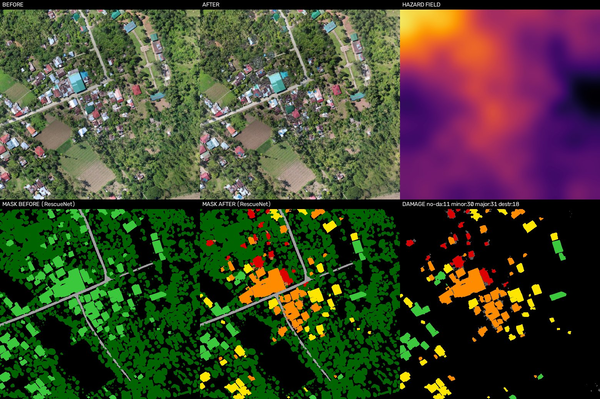
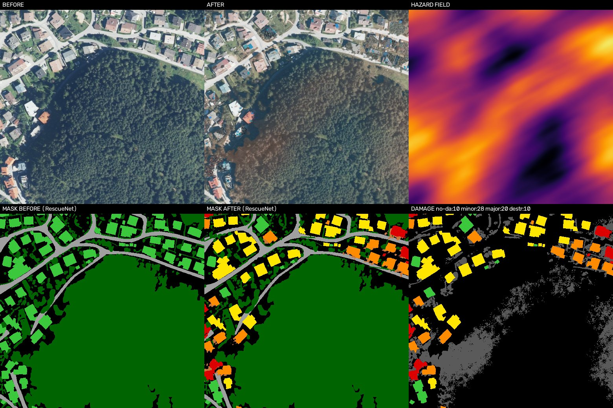
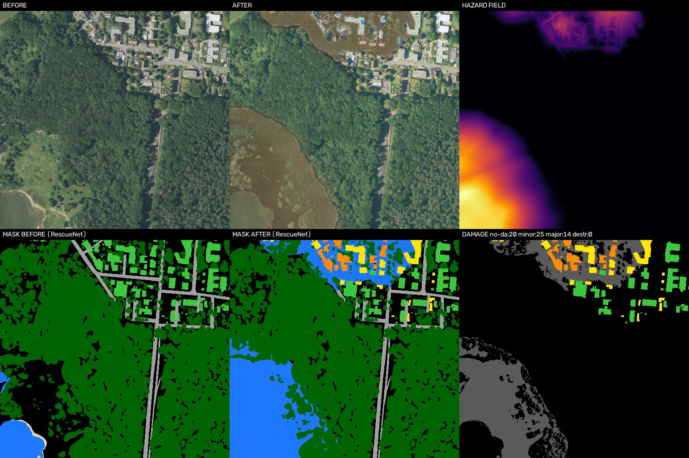
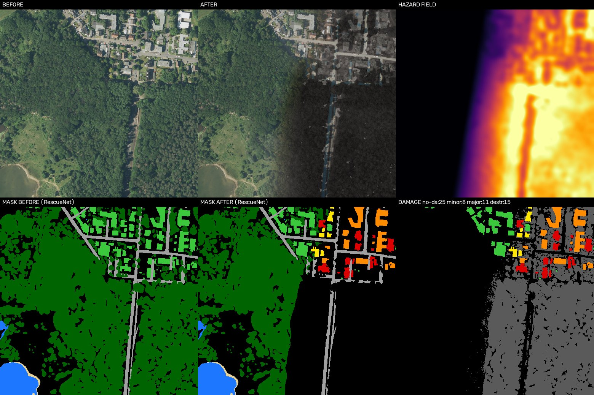

# Village → post-catastrophe : images aériennes synthétiques enrichies

Ce projet prend une image aérienne d'un **village intact**, avec son masque de labels, et produit
**le même village après une catastrophe** : séisme, ouragan, tornade, inondation ou feu de forêt.
Chaque résultat est livré avec :

- l'**image après**, alignée au pixel près avec l'image avant ;
- le **masque après** aux classes **RescueNet**, pour la segmentation des dégâts ;
- le **masque de dégâts au format xBD / xView2**, en image et en JSON avec un polygone par bâtiment ;
- la **carte de changement** et la **carte d'aléa** qui a servi à placer les dégâts ;
- des **crops enrichis avec [Albumentations](https://albumentations.ai)**, prêts pour l'entraînement.

Tout se passe d'image à image, sans prompt texte ni modèle génératif : les effets sont du code
(OpenCV et NumPy), donc reproductibles et labellisés exactement.


### Ce qui est nouveau par rapport à une approche « LoveDA + dégâts tirés au hasard »

| | Approche de référence | Ce projet |
|---|---|---|
| Données | LoveDA (Chine, 2 villes) | OpenEarthMap, **44 pays**, sélection automatique de villages + contrôle qualité |
| Placement des dégâts | Tirage indépendant par maison | **Carte d'aléa physique** par catastrophe (épicentre, vent, couloir, profondeur d'eau, front de feu) |
| Catastrophes | 4 | **5** (+ feu de forêt) |
| Textures de débris | Extraits de RescueNet (téléchargement Kaggle) | 100 % procédural : décombres faits **du toit de la maison** + sol local |
| Arbres | Collés en travers des routes | **Tombent dans le sens du vent**, le sol réapparaît (inpainting) |
| Eau | Couleur uniforme | Opacité selon la **profondeur**, courant, laisse de crue |
| Labels | RescueNet | RescueNet **+ xBD** (image + polygones JSON) + carte d'aléa |
| Albumentations | Option flip/rotation | Rendu **post-événement** + crops **alignés** avant/après pour la détection de changement |

---

## 1. Les données d'entrée

Les villages viennent d'**OpenEarthMap** (Xia et al., WACV 2023) : 5 000 images aériennes et
satellite, de 0,25 à 0,5 m par pixel, prises dans 97 régions de 44 pays et annotées en 8 classes.
On utilise le miroir Hugging Face [`EVER-Z/open_earth_map`](https://huggingface.co/datasets/EVER-Z/open_earth_map).

`download_villages.py` choisit les scènes **sans télécharger les 6 Go** :

1. Il lit seulement la colonne `mask` des fichiers Parquet, par requêtes HTTP partielles.
   Ces masques sont des PNG sans perte de quelques dizaines de Ko.
2. Il note chaque masque. Un *village*, c'est 15 à 220 maisons isolées, 3 à 15 % de bâti, plus
   de 55 % de champs, prairies ou arbres, et des routes. Une scène qui ne remplit pas ces critères
   (centre-ville ou champ vide) est écartée.
3. Il prend le meilleur village de **chaque région** avant d'en prendre un second, pour la
   diversité géographique.
4. Il fait un contrôle qualité de l'image : il rejette les bordures sans données, le voile ou les
   nuages (*dark channel prior*) et le contraste trop faible.

Échantillon inclus dans `data/villages/`, avec 8 villages de 8 régions, tous vérifiés visuellement :

| Village | Pays | Maisons | Bâti | Champs / arbres / prairie |
|---|---|---|---|---|
| `aachen_70` | Allemagne | 99 | 7 % | 84 % |
| `muenster_62` | Allemagne | 79 | 7 % | 84 % |
| `koeln_31` | Allemagne (lac) | 64 | 6 % | 81 % |
| `tyrolw_66` | Autriche | 67 | 12 % | 75 % |
| `baybay_29` | Philippines | 85 | 13 % | 81 % |
| `mahe_65` | Seychelles | 73 | 12 % | 80 % |
| `zanzibar_112` | Tanzanie | 71 | 4 % | 87 % |
| `austin_48` | USA | 76 | 12 % | 73 % |

**Régions exclues par défaut.** Une partie d'OpenEarthMap provient de campagnes de cartographie de
catastrophes (Joplin, Houston, Haïti, Palu, Tonga…). Certaines de ces tuiles sont prises *après*
l'événement : la première sélection contenait par exemple Tonga après le cyclone Gita, avec des
débris et des arbres effeuillés. Ces régions sont donc ignorées (`DISASTER_REGIONS`). On peut les
réactiver avec `--allow-disaster-regions`.

Classes d'OpenEarthMap : 0 inconnu, 1 sol nu, 2 prairie, 3 espace aménagé, 4 route, 5 arbre,
6 eau, 7 agriculture, 8 bâtiment. Elles sont converties en classes RescueNet : bâtiment → bâtiment
intact, route → route, eau → eau, arbre → arbre, sol nu → sable/sol, le reste → fond.

```bash
python download_villages.py --n 8 --out data/villages          # environ 2 min, une centaine de Mo lus
python download_villages.py --n 40 --per-region 2 --out data/villages_big
```

---

## 2. Comment c'est généré

```
image + masque ──► carte d'ALÉA ──► niveau de dégât par bâtiment ──► rendu ──► capteur ──► albumentations
                   (physique)        (modèle ordinal)               (code)    (bruit/flou)  (post-event + crops)
```

### 2.1 Une carte d'aléa physique, pas un tirage au hasard maison par maison

Les dégâts suivent un **champ continu** propre à chaque catastrophe. Les maisons voisines sont donc
touchées de façon similaire, comme sur de vraies images post-événement.

| Catastrophe | Modèle d'aléa |
|---|---|
| **Séisme** | Épicentre, parfois hors de l'image ; atténuation exponentielle avec la distance ; amplification locale du sol (bruit fractal) |
| **Ouragan** | Direction du vent ; rafales étirées dans le sens du vent (flou directionnel) |
| **Tornade** | Couloir ondulé de 60 à 250 m de large ; débris projetés le long de la trajectoire |
| **Inondation** | **Pseudo-MNT** : terrain bas près des rivières et des routes, maisons légèrement surélevées ; un niveau d'eau donne une **profondeur** en chaque point |
| **Feu de forêt** | Front de feu qui entre par un côté et avance selon le **combustible** (végétation détectée par excès de vert et classe arbre) |

Le niveau de dégât d'un bâtiment vient d'un **modèle ordinal** : `z = aléa moyen sur l'emprise + vulnérabilité + bruit`,
comparé à trois seuils (mineur / majeur / détruit). La vulnérabilité est plus forte pour les petites
maisons légères. Pour l'inondation, c'est la **profondeur autour** de la maison qui compte.

### 2.2 Rendu des dégâts

Tout est procédural et à l'**échelle métrique** : les tailles sont en mètres, converties avec le GSD.

- **Toit endommagé (mineur)** : tuiles arrachées en bandes dans le sens du vent, voligeage apparent,
  bâches bleues.
- **Effondrement partiel (majeur)** : l'emprise est coupée par une ligne aléatoire. Un côté s'effondre
  en décombres sombres (intérieur visible), l'autre garde un toit abîmé.
- **Destruction totale** : **décombres de Voronoï faits du propre toit de la maison**. Chaque fragment
  copie un morceau du toit avec une rotation et une teinte aléatoires, mêlé à de la poussière couleur
  du **sol local** (pas une moyenne globale). S'y ajoutent des morceaux de **murs restés debout** et
  la suppression de l'ombre portée.
- **Traînées de débris** orientées dans le sens du vent ou de la tornade, plus denses près de la
  maison, labellisées `debris`.
- **Arbres** : en vent fort, un arbre isolé **tombe dans le sens du vent**. L'endroit où il était
  est **inpainté** : le sol réapparaît et le masque passe de `tree` à fond. Le reste de la végétation
  est effeuillé ou bruni dans la zone d'aléa.
- **Occlusion** : les couronnes d'arbres qui surplombent une maison abîmée restent au-dessus des
  décombres.
- **Inondation** : eau chargée de sédiments dont l'**opacité dépend de la profondeur**. Les bas-fonds
  restent translucides et les couronnes d'arbres émergent. S'y ajoutent des stries de sédiments dans
  le sens du courant, un reflet du ciel, une **laisse de crue** (ligne de débris flottants) au bord,
  le sol humide autour et la boue sur les champs.
- **Feu** : la cicatrice de brûlure **garde la structure** de ce qui était là (squelettes d'arbres,
  parcelles) mais en charbon, avec des plaques de cendre, une marge roussie et des maisons brûlées
  (toit noir, cendre, murs). Des panaches de fumée légers partent du front de feu et dérivent avec
  le vent.
- **Séisme** : poussière en plaques légères au-dessus des effondrements.
- **Cohérence capteur** : les zones peintes reçoivent le **même niveau de bruit** que la photo
  (estimation robuste par MAD) et un léger flou.

### 2.3 Albumentations, à deux endroits

1. **Image post-événement** (`postdisaster/augment.py: post_event`). L'image après est prise par un
   autre vol ou satellite, un autre jour. On n'applique que des transformations au niveau pixel, donc
   les masques restent exacts :
   - courbe de tons, teinte et saturation ;
   - bruit capteur `ISONoise` ou `GaussNoise`, `Downscale`, `ImageCompression` ;
   - `PlasmaShadow`, des ombres de nuages douces après un ouragan, une crue ou une tornade ;
   - `PlasmaBrightnessContrast` pour la lumière inégale sous la poussière ou la fumée.

   La liste des transformations réellement appliquées est enregistrée pour chaque image (`manifest.csv`, JSON).
2. **Enrichissement du jeu de données** (`paired_crops`) :
   - **les mêmes transformations géométriques** (`D4`, `Affine` rotation et échelle,
     `CropNonEmptyMaskIfExists` centré sur les zones changées) sont appliquées à l'image avant, à
     l'image après et à tous les masques via `additional_targets`, ce qui garde l'alignement ;
   - les **transformations de couleur sont tirées indépendamment** pour l'avant et l'après :
     luminosité et contraste, HSV, flou, `Sharpen`, bruit. C'est ce qu'il faut pour entraîner un
     modèle de détection de changement.

Deux pièges d'Albumentations 2.0 ont été rencontrés et corrigés :

- `RandomFog` floute toute la tuile et rend les dégâts invisibles. Il est remplacé par nos propres
  effets de poussière et de fumée.
- Avec `Compose(seed=…)`, tous les enfants tirent le même premier nombre aléatoire, donc ils
  s'appliquent tous ou aucun. La fonction `seeded()` donne une graine propre à chaque transformation.

---

## 3. Sorties

Dossier : [`output/`](output). Le nom d'un échantillon est `<village>_<catastrophe>_<i>`.

| Dossier | Contenu |
|---|---|
| `before/<village>.jpg`, `masks_before/<village>_lab.png` | Village intact et ses labels RescueNet (une fois par village) |
| `after/<nom>.jpg` | Image post-catastrophe |
| `masks/<nom>_lab.png` | Labels après, **RescueNet Kaggle v1.0** |
| `xbd/<nom>_damage.png` | Dégâts par pixel, **échelle xBD** : 0 fond, 1 intact, 2 mineur, 3 majeur, 4 détruit |
| `labels_xbd/<nom>.json` | Un polygone WKT par bâtiment, avec `subtype` (dégât), aléa et surface en m², disposition du JSON xBD |
| `change/<nom>_change.png` | 255 = modifié par la catastrophe |
| `hazard/<nom>_hazard.png` | Carte d'aléa (0–255) |
| `previews/<nom>_preview.jpg` | Avant, après, aléa / masque avant, masque après, dégâts |
| `augmented/{before,after,masks_before,masks,xbd,change}/` | Crops Albumentations 512 × 512 alignés |
| `manifest.csv`, `summary.json` | Une ligne par échantillon : sévérité, nombre de bâtiments par niveau, % changé, transformations appliquées |

Labels RescueNet (Kaggle v1.0) :

| ID | Classe | ID | Classe |
|---|---|---|---|
| 0 | fond | 6 | bâtiment détruit |
| 1 | débris | 7 | véhicule |
| 2 | eau | 8 | route |
| 3 | bâtiment intact | 9 | arbre |
| 4 | bâtiment dégât mineur | 10 | piscine |
| 5 | bâtiment dégât majeur | 11 | sable / sol nu |

### Exemples

Chaque aperçu montre, en haut, l'avant, l'après et la carte d'aléa ; en bas, le masque avant, le
masque après et les dégâts (vert intact, jaune mineur, orange majeur, rouge détruit, gris = autre
changement).

**Séisme** (Philippines) : épicentre hors champ en haut à gauche, dégâts groupés.


**Ouragan** (Autriche) : rafales orientées, toits arrachés, forêt effeuillée.


**Inondation** (Allemagne) : le lac déborde ; eau opaque au fond, translucide sur les bords.


**Feu de forêt** (Allemagne) : le front de feu arrive par l'est et brûle la forêt et le quartier.


Bilan des 40 échantillons (bâtiments par niveau de dégât, `output/summary.json`) :

| Catastrophe | Intact | Mineur | Majeur | Détruit |
|---|---|---|---|---|
| Séisme | 106 | 194 | 176 | 135 |
| Ouragan | 136 | 304 | 146 | 25 |
| Tornade | 432 | 60 | 31 | 88 |
| Inondation | 315 | 180 | 99 | 17 |
| Feu | 414 | 77 | 49 | 71 |

Les tornades et les feux laissent beaucoup de maisons intactes : seul le couloir ou le front est
touché, comme dans la réalité.

---

## 4. Utilisation

```bash
pip install -r requirements.txt

# 1) des villages intacts (déjà inclus dans data/villages)
python download_villages.py --n 8 --out data/villages

# 2) les catastrophes
python generate.py                                        # 8 villages × 5 catastrophes
python generate.py --scenarios flood wildfire --n-per-scenario 3 --severity 0.6
python generate.py --aug-crops 8 --crop-size 256          # plus de crops pour l'entraînement
```

| Option | Rôle |
|---|---|
| `--scenarios` | `earthquake hurricane tornado flood wildfire` (tous par défaut) |
| `--n-per-scenario` | Versions par village et par catastrophe (graines différentes) |
| `--severity` | 0–1, ± 0,1 aléatoire (0,75 par défaut) |
| `--gsd` | Mètres par pixel (0,3 par défaut ; OpenEarthMap va de 0,25 à 0,5) |
| `--aug-crops`, `--crop-size` | Crops Albumentations par échantillon (2 × 512 par défaut, 0 pour désactiver) |
| `--no-sensor-shift` | Pas de transformation post-événement sur l'image après |
| `--seed` | Tout est reproductible à graine égale |

## 5. Organisation du code

| Fichier | Rôle |
|---|---|
| `download_villages.py` | Sélection et téléchargement des villages OpenEarthMap |
| `generate.py` | Programme principal : boucle, sorties, aperçus, JSON xBD, manifeste |
| `postdisaster/classes.py` | Classes OpenEarthMap → RescueNet → xBD, palettes |
| `postdisaster/hazard.py` | Cartes d'aléa physiques et modèle ordinal des dégâts |
| `postdisaster/effects.py` | Rendu : toits, effondrements, décombres de Voronoï, débris, arbres, eau, feu, fumée |
| `postdisaster/pipeline.py` | Enchaînement d'un scénario, séparation des maisons (watershed sur l'image), carte de changement |
| `postdisaster/augment.py` | Albumentations : image post-événement et crops appariés |

## 6. Limites et licences

- Les images sont **synthétiques**. Elles servent à augmenter un jeu d'entraînement ; **l'évaluation
  doit se faire sur de vraies images** (RescueNet, xBD).
- Les maisons cachées sous les arbres sont labellisées « bâtiment » par OpenEarthMap. Leurs dégâts
  restent en partie cachés par les couronnes, comme sur une vraie photo.
- Le pseudo-MNT de l'inondation ne vient pas d'un vrai relief. L'eau monte depuis les rivières, les
  lacs et les routes, mais peut parfois couvrir un endroit qui serait en hauteur en réalité. Avec un
  MNT réel (par exemple SRTM ou Copernicus DEM), il suffirait de remplacer `elev` dans `hazard.flood`.
- Quelques tuiles OpenEarthMap issues de drone ont de petits trous sans données (points noirs ou
  blancs, par exemple `mahe_65`).
- **OpenEarthMap** est distribué pour la recherche (CC BY-NC-SA 4.0 pour les labels ; les images
  viennent de plusieurs sources). L'échantillon inclus et les images générées sont donc pour un
  **usage de recherche non commercial**. Citez : Xia, J., Yokoya, N., Adriano, B., Broni-Bediako, C.
  *OpenEarthMap: A Benchmark Dataset for Global High-Resolution Land Cover Mapping*, WACV 2023.
- Albumentations : Buslaev et al., *Albumentations: Fast and Flexible Image Augmentations*,
  Information 2020.
