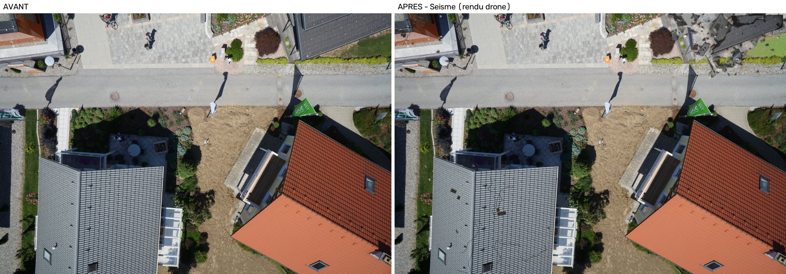
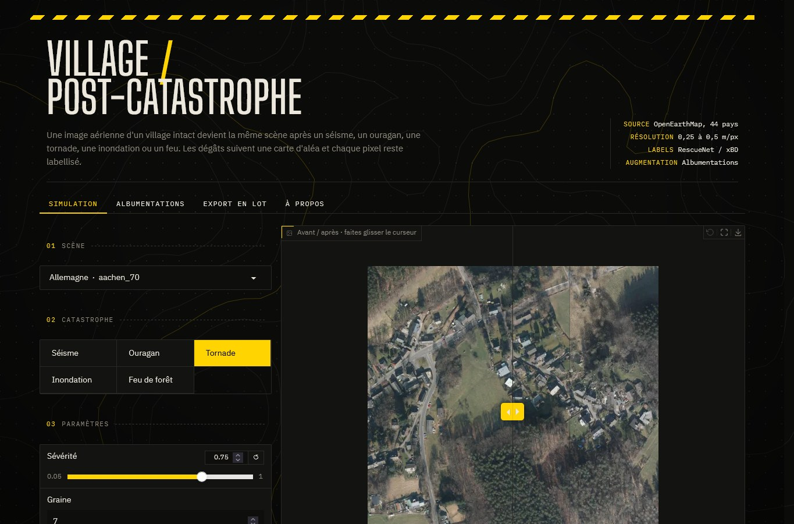
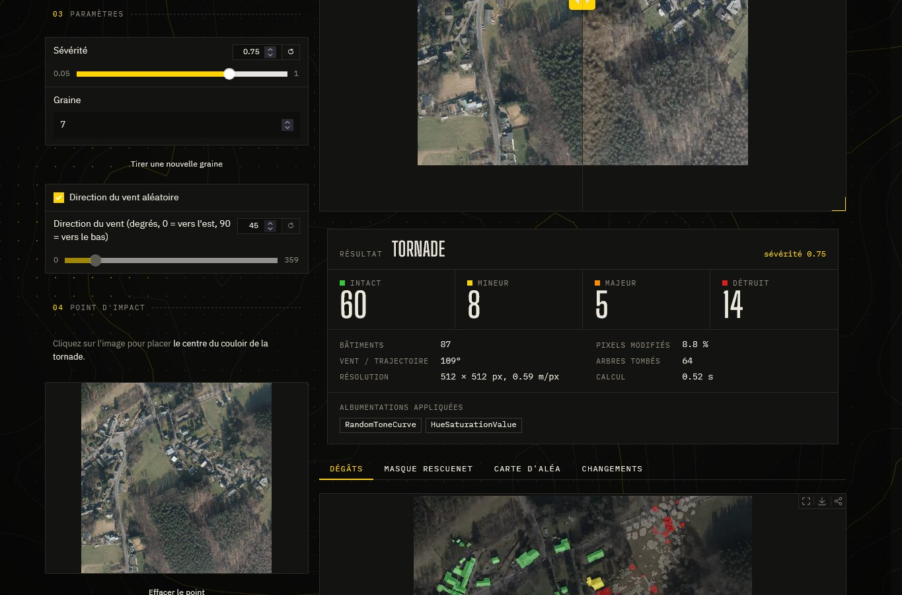
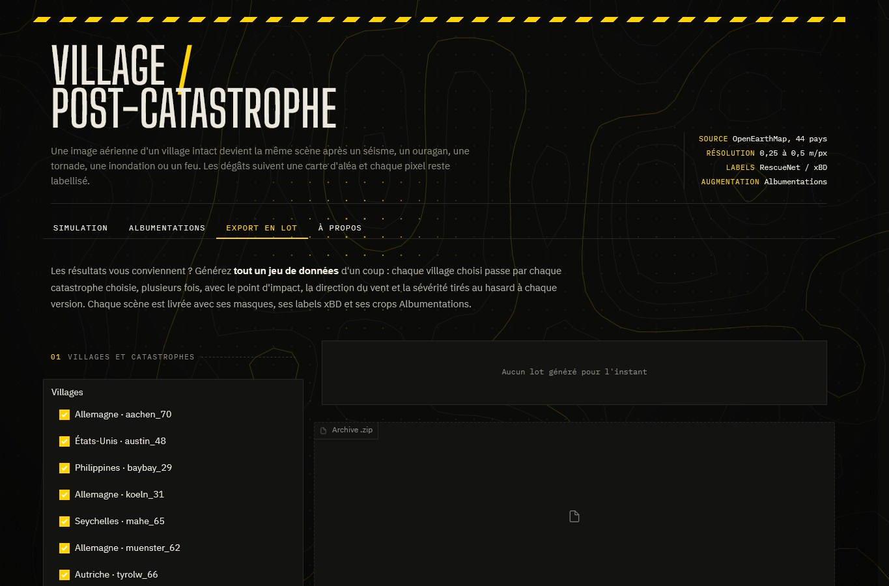
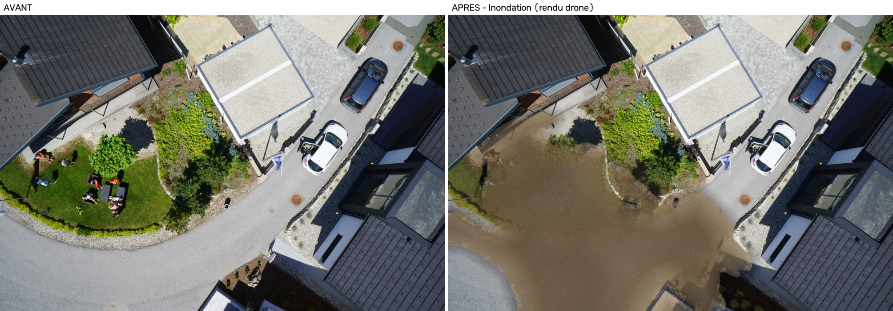
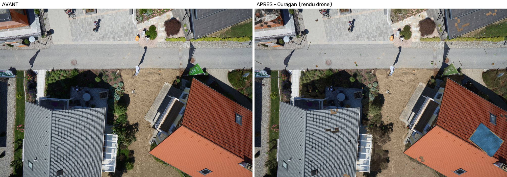
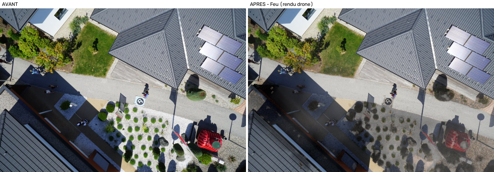

<div align="center">

# Village → post-catastrophe

**Simulez une catastrophe sur une vraie image aérienne ou drone et récupérez les labels de dégâts au pixel près.**

Séisme · Ouragan · Tornade · Inondation · Feu de forêt


*Village de Münster (Allemagne) frappé par une tornade (image aérienne, 0,3 m/px).*



*Maisons à Graz (Autriche) après un séisme : photo drone à environ 3 cm/px, rendu « drone » avec gravats en relief.*

</div>

<details>
<summary><b>Lire la première image</b></summary>

<br>

**Ligne du haut : les images**

| Panneau | Ce qu'il montre |
|---|---|
| **BEFORE** | La vraie photo aérienne d'OpenEarthMap : un lotissement en haut, un bois au centre, des champs en bas. |
| **AFTER** | La même scène après la tornade, générée par le code. Le long d'une bande diagonale, le bois et le champ sont roussis par le vent ; en haut à droite, les maisons sont effondrées ou ont le toit abîmé (bâches bleues). Hors de la bande, rien ne change. |
| **HAZARD FIELD** | La carte d'aléa, c'est-à-dire la force de la tornade en chaque point (noir = rien, jaune clair = maximum). On y voit le couloir de la tornade, et c'est lui qui décide de tout le reste. |

**Ligne du bas : les labels**

| Panneau | Ce qu'il montre |
|---|---|
| **MASK BEFORE (RescueNet)** | Le masque d'origine : vert clair = bâtiment intact, vert foncé = arbre, gris = route, bleu = eau, noir = sol. |
| **MASK AFTER (RescueNet)** | Le masque après la catastrophe : les maisons touchées changent de couleur selon leur niveau de dégâts. Il correspond exactement à l'image AFTER, car le code l'écrit en même temps qu'il dessine. |
| **DAMAGE** | La vue xBD, réduite aux bâtiments. En gris, les pixels hors bâtiment modifiés par la tornade (végétation abîmée, débris). |

**Couleurs des dégâts** : 🟩 intact · 🟨 mineur · 🟧 majeur · 🟥 détruit.

Le titre du dernier panneau donne le bilan : `no-da:43 minor:9 major:7 destr:19`, soit 43 maisons
intactes, 9 avec des dégâts mineurs, 7 avec des dégâts majeurs et 19 détruites. Les maisons rouges et
orange se trouvent toutes dans le couloir jaune de la carte d'aléa : les dégâts suivent un phénomène
cohérent au lieu d'être tirés au hasard maison par maison.

</details>

---

## À quoi ça sert

Les images aériennes prises **après** une catastrophe, et annotées, sont rares. Ce projet part d'une
**scène intacte** dont on connaît déjà chaque bâtiment, arbre, route ou cours d'eau, et fabrique la
**même scène après la catastrophe**. Comme c'est le code qui dessine les dégâts, il écrit en même
temps les **labels exacts**, prêts pour entraîner un modèle de détection ou de segmentation des
dégâts.

Deux types d'images sont gérés, chacun avec son propre moteur de rendu :

| | Images aériennes / satellite | Images drone |
|---|---|---|
| Source | **OpenEarthMap** [1], 44 pays | **Semantic Drone Dataset** [24], Graz (Autriche) |
| Résolution | 0,25 à 0,5 m/px | environ 2 à 3 cm/px |
| Ce qu'on voit | un quartier entier, des dizaines de maisons | 2 à 5 maisons, chaque tuile est visible |
| Rendu | **aérien (2D)** : textures dessinées à plat | **drone (2,5D)** : relief, soleil, ombres portées |

Tout se pilote depuis un **site web local** : on choisit une scène et une catastrophe, on clique là
où elle frappe, et le résultat s'affiche en quelques secondes.

---

## Lancer le site

Il faut **Python 3.10 ou plus récent** ([python.org](https://www.python.org/downloads/)).

```bash
git clone https://github.com/Moha-df/post-disaster-villages.git
cd post-disaster-villages
python -m venv .venv
```

Activer l'environnement, puis installer et lancer :

```bash
# Windows (PowerShell)
.\.venv\Scripts\Activate.ps1
# macOS / Linux
source .venv/bin/activate

pip install -r requirements.txt
python download_drone.py     # optionnel : ajoute les 3 scènes drone (environ 13 Mo)
python app.py
```

Ouvrir **http://127.0.0.1:7860** dans le navigateur.

> **`pip` introuvable sous Windows ?** C'est souvent que Python n'est pas installé : la commande
> `python` ouvre alors seulement le Microsoft Store. Installez Python (par exemple
> `winget install Python.Python.3.12`), rouvrez le terminal, et utilisez `python -m pip` à la place
> de `pip`.

> **Pourquoi les scènes drone ne sont-elles pas dans le dépôt ?** Le Semantic Drone Dataset est
> gratuit pour un usage non commercial, mais il faut le récupérer à sa source. `download_drone.py`
> lit seulement les morceaux utiles de l'archive Kaggle (4 Go) par requêtes HTTP partielles, sans
> compte : environ 40 Mo téléchargés pour 3 scènes.

---

## Le site

### 1. Simulation

<div align="center"></div>

- **Scène** : 8 villages OpenEarthMap (Allemagne, Autriche, États-Unis, Philippines, Seychelles,
  Zanzibar), les scènes drone de Graz si `download_drone.py` a été lancé, ou **votre propre image**
  avec son masque OpenEarthMap.
- **Catastrophe** : séisme, ouragan, tornade, inondation ou feu de forêt.
- **Sévérité** de 0,05 à 1, et une **graine** pour retrouver exactement le même résultat.
- **Cliquer sur l'image** pour placer l'épicentre du séisme, le passage de la tornade ou le point de
  départ du feu.
- **Direction du vent** (ouragan, tornade, feu) ou **surface inondée** (inondation).
- **Rapide (512 px)** pour explorer, **Complet (1000 px)** pour la qualité finale.
- **Rendu** : *Auto* choisit le rendu drone sous 12 cm/px et le rendu aérien au-dessus ; on peut forcer
  l'un ou l'autre.
- Option **aspect post-événement** : l'image « après » prend l'allure d'une autre prise de vue
  (couleurs, bruit, ombres de nuages).

### 2. Résultats

<div align="center"></div>

- **Curseur avant / après** pour comparer les deux images.
- Onglets **Dégâts** (niveau de chaque maison), **Masque RescueNet**, **Carte d'aléa** et
  **Changements**.
- Le panneau de statistiques indique le **rendu utilisé** et la résolution réelle (cm/px ou m/px).
- **Télécharger le résultat** en `.zip` : images, masques, labels xBD et métadonnées.

### 3. Albumentations

Montre l'effet du rendu « post-événement » (rendu brut vs. avec Albumentations) et génère des
**crops alignés** avant / après / masques, comme ceux utilisés pour l'entraînement.

### 4. Export en lot

<div align="center"></div>

Génère d'un coup **toutes les scènes × toutes les catastrophes**, en plusieurs versions chacune
(point d'impact, vent et sévérité tirés au hasard dans une plage), avec jusqu'à 16 crops par scène.
Le tout sort dans **un seul `.zip`** : images, masques, labels xBD, crops et `manifest.csv`.

### 5. À propos et Documentation

*À propos* résume la démarche. *Documentation* explique tout en 10 pages : vue d'ensemble, données
d'entrée, aléa et dégâts, une page par catastrophe (modèle d'aléa avec ses formules, rendu aérien, rendu
drone), le moteur drone (soleil, éclairage, ombres, gravats, pans de toit, tuiles), capteur et sorties, et
le code (appel d'un scénario, options, comment ajouter une catastrophe ou un jeu de données).

---

## Comment ça marche

```
image + masque (OpenEarthMap, ou Semantic Drone Dataset converti)
        │
        ▼
 ① séparation des maisons      ──  watershed sur l'image
        │
        ▼
 ② carte d'aléa  [0, 1]        ──  un modèle physique simplifié par catastrophe
        │
        ▼
 ③ niveau de dégâts par maison ──  intact · mineur · majeur · détruit
        │
        ▼
 ④ rendu des dégâts            ──  aérien (2D)   si résolution ≥ 12 cm/px
        │                          drone (2,5D)  si résolution < 12 cm/px
        │                          (le masque est écrit en même temps)
        ▼
 ⑤ raccord capteur + Albumentations
        │
        ▼
 image « après » + masques RescueNet / xBD + crops
```

Les étapes ①, ② et ③ sont **communes** aux deux types d'images : seule l'étape ④ change.

### ① Partir d'une scène annotée

L'entrée est une photo et son **masque de segmentation** annoté à la main :

- **OpenEarthMap** [1] : 8 = bâtiment, 4 = route, 5 = arbre, 6 = eau…
- **Semantic Drone Dataset** [24] : 24 classes (toit, mur, fenêtre, porte, zone pavée, gazon,
  végétation, arbre, eau, piscine, voiture…). `download_drone.py` les convertit en classes
  OpenEarthMap (toit, mur, fenêtre et porte → bâtiment ; zone pavée et voiture → route ; arbre et
  végétation → arbre ; eau et piscine → eau ; gazon → prairie ; terre, gravier et roche → sol nu…).
  Les images sont réduites à 1536 px de large ; la résolution au sol, que le jeu de données ne donne
  pas, a été estimée d'après la taille des voitures (environ 4,5 m pour 770 px en pleine résolution,
  soit 0,55 cm/px puis environ 2,2 cm/px après réduction).

Le masque est ensuite converti dans les classes de **RescueNet** [2]. Les bâtiments collés les uns
aux autres sont séparés en maisons individuelles par une **ligne de partage des eaux (watershed)**
[8] calculée sur l'image, à partir des empreintes érodées. Les pixels orphelins vont à la maison la
plus proche grâce à une **transformée de distance** [9].

### ② Carte d'aléa : où la catastrophe frappe

Les dégâts ne sont pas tirés maison par maison au hasard : ils suivent un champ continu, si bien que
des maisons voisines ont des dégâts proches, comme dans la réalité. Le relief et les variations
locales viennent d'un **bruit fractal (fBm)** multi-octaves [10, 11].

| Catastrophe | Modèle d'aléa | Inspiré de |
|---|---|---|
| **Séisme** | Atténuation exponentielle avec la distance à l'épicentre + amplification par les sols mous (bruit) | Lois d'atténuation et cartes d'intensité de type ShakeMap [13] |
| **Ouragan** | Rafales : bruit fractal étiré dans la direction du vent | — |
| **Tornade** | Couloir étroit et légèrement sinueux, dégâts maximaux au centre | Relevés de traces de tornade, échelle de Fujita améliorée [14] |
| **Inondation** | Pseudo-relief : bas près des rivières et des routes ; le niveau d'eau est fixé pour couvrir la surface voulue | Hauteur au-dessus du réseau de drainage (HAND) [15] |
| **Feu de forêt** | Front de feu qui avance avec le vent, plus vite en aval (forme elliptique), et brûle là où il y a du combustible | Propagation de Rothermel [16] et forme elliptique d'Anderson [17] ; végétation repérée par l'indice *Excess Green* [12] |

### ③ Niveau de dégâts de chaque maison

Chaque maison reçoit un score : **aléa moyen sur son emprise + vulnérabilité + bruit**. Les petites
maisons sont un peu plus fragiles que les grandes. Ce score est comparé à trois seuils propres à
chaque catastrophe pour donner l'un des 4 niveaux de l'échelle **xBD** [3] (intact, mineur, majeur,
détruit). C'est un **modèle ordinal à seuils** [18], dans l'esprit des courbes de fragilité de
**HAZUS** [19]. Pour l'inondation, c'est la profondeur d'eau juste autour de la maison qui compte.

### ④ Rendu des dégâts

Aucune texture n'est copiée d'un autre jeu de données : les décombres sont faits avec le propre toit
de la maison. Toutes les tailles sont exprimées **en mètres** puis converties en pixels avec la
résolution de l'image, si bien qu'une tuile fait toujours 25 cm et une planche 1 à 2 m.

#### Rendu aérien (2D) — `postdisaster/effects.py`

À 0,3 m/px, une maison fait quelques centaines de pixels : une texture dessinée à plat suffit.

- **Toits abîmés** : tuiles arrachées dans le sens du vent, voligeage apparent, bâches bleues.
- **Effondrement** partiel ou total : le toit est cassé en **fragments de Voronoï** [20], chacun
  pivoté et assombri, avec de la poussière couleur du sol local ; des pans de murs restent debout, et
  l'ombre portée du bâtiment disparaît.
- **Traînées de débris** emportées par le vent.
- **Arbres couchés** dans le sens du vent : le sol caché sous la couronne est reconstruit par
  **inpainting de Telea** [21].
- **Végétation** jaunie par le vent ou couverte de boue après l'inondation.
- **Eau de crue** boueuse, transparente là où elle est peu profonde, avec traînées de sédiments,
  reflets, ligne de débris flottants au bord et sol mouillé autour.
- **Feu** : cendres, zones carbonisées, lisière roussie, maisons brûlées et panaches de fumée.
- **Poussière** après un séisme, sur toute l'image.

#### Rendu drone (2,5D) — `postdisaster/drone.py`

À 2 cm/px, l'œil attend du **relief** : des morceaux posés les uns sur les autres, éclairés par le
soleil, qui projettent leur ombre. Le rendu aérien y paraît plat (mosaïque collée sur le toit). Le
rendu drone fonctionne donc autrement : chaque débris a une **couleur**, une **couverture** et une
**hauteur en mètres**, et c'est cette carte de hauteur qui est éclairée.

| Brique | Méthode |
|---|---|
| **Direction du soleil** | Estimée **sur la photo** : on décale les empreintes des bâtiments de 1,2 m dans 24 directions et on mesure la luminosité du sol découvert ; la direction la plus sombre est celle des ombres, le soleil est à l'opposé. Le rapport ombre / sol éclairé donne la lumière ambiante. |
| **Éclairage** | Modèle de **Lambert** sur la carte de hauteur : la normale est calculée à partir du gradient (en mètres), comparée à la direction du soleil (élévation 42°), et normalisée pour que le sol plat garde sa luminosité d'origine. |
| **Ombres portées** | **Lancer de rayons** sur la carte de hauteur : chaque pixel regarde vers le soleil, pas à pas, et il est à l'ombre si un point plus haut que le rayon le cache. Les ombres tombent aussi sur le sol autour des débris. |
| **Occlusion ambiante** | Les creux (hauteur plus basse que la moyenne locale sur 25 cm) sont assombris : interstices entre les gravats. |
| **Matériaux** | Le **vrai toit** de la maison (copié, tourné), béton, enduit, brique, bois (avec veinage), chacun avec un grain à sa taille réelle. |

**Séisme**

- *Dégâts mineurs* : **tuiles manquantes** découpées rangée par rangée, en suivant les joints des
  tuiles (le sens des rangées est mesuré sur le toit par un **tenseur de structure**). Dans le trou,
  on voit l'écran sous toiture noir et les **liteaux** tous les 33 cm, ou parfois les panneaux de
  voligeage ; quelques tuiles restent accrochées, et le bord du trou porte une petite ombre. Fines
  **fissures** en marche aléatoire. Les tuiles tombées gisent au pied des murs, avec leur ombre.
- *Dégâts majeurs* : une partie du toit (d'un côté d'une ligne irrégulière) s'**effondre** : tas de
  gravats bas, **trous sombres** vers l'intérieur de la maison, **pans de toit** inclinés qui pendent
  dans le trou et **chevrons** encore en place dans le sens de la pente.
- *Détruit* : **tas de gravats** en forme de monticule (jusqu'à 1,6 m), qui déborde un peu sur le sol.
  Il est fait de trois tailles de morceaux (dalles de 0,5 à 1,5 m, blocs de 15 à 45 cm, petits débris
  de 4 à 12 cm), d'un gravier de fond et d'une fine couche de poussière. Par-dessus, de **grands pans
  du vrai toit** (2 à 4 m) cassés le long de lignes déchiquetées, glissés vers le centre, légèrement
  tournés et inclinés : on reconnaît encore la maison. L'ombre portée de la maison d'origine disparaît.
- Quelques débris tombent **près** de la maison (moins de 2 m) ; **nuage de poussière** local autour
  des effondrements, et non un voile sur toute l'image.

**Ouragan et tornade**

- *Mineur* : grandes plaques de tuiles arrachées, voligeage plus souvent à nu, **bâches bleues** avec
  plis (relief en bruit étiré) et planches ou sacs de sable sur les bords.
- *Majeur / détruit* : comme le séisme, mais avec plus de **bois** (charpente) et des gravats plus
  bas.
- Les débris sont projetés **sous le vent**, sur 7 à 13 m, avec plus de planches orientées dans le
  sens du vent.
- **Feuilles et branches** arrachées aux arbres et aux haies, poussées sous le vent (à cette échelle,
  déplacer un arbre entier donnerait une découpe collée ; les arbres restent en place et perdent des
  feuilles).

**Inondation**

- **Eau à l'échelle de la rue** : le relief combine la pente générale de la carte d'aléa (très lissée)
  et le type de sol (routes plus basses, pelouses plus hautes, bâtiments au sec). Le niveau est fixé
  pour couvrir la surface voulue ; l'eau remplit donc la rue et les jardins avec des bords nets.
- **Transparence selon la profondeur** : près du bord on voit encore le sol, légèrement flou
  (réfraction) et teinté ; au loin l'eau devient opaque et plus sombre.
- **Vaguelettes** (bruit étiré perpendiculairement au courant, éclairé par le soleil) avec **reflets**
  du ciel et éclats de lumière, **volutes de sédiments** dans le sens du courant.
- **Écume** et petits débris au bord, **objets flottants** (planches, morceaux) orientés par le
  courant, **sol mouillé** juste autour.
- Les maisons ne s'effondrent pas en tas : leurs dégâts se lisent par l'eau ; les plus touchées
  perdent une partie de leur toit.

**Feu de forêt**

- *Mineur* : **suie** sur le bord du toit du côté du feu, quelques tuiles éclatées.
- *Majeur / détruit* : gravats **carbonisés** (charbon, cendre blanche, tôles rouillées), sans
  morceaux de toit intacts.
- **Sol brûlé** : seule la **végétation** devient du charbon (grain fin) avec des plaques de cendre ;
  les dalles, le gravier et les objets sont seulement noircis par la suie, leur texture reste
  lisible. Fumée qui dérive sous le vent.

<div align="center">

| Inondation | Ouragan | Feu |
|---|---|---|
|  |  |  |

</div>

### ⑤ Raccord capteur et Albumentations

Pour que les zones redessinées ne paraissent pas « trop propres », le flou et le bruit du vrai capteur
sont mesurés (estimation robuste du bruit par la **médiane des écarts absolus**, MAD [22]) puis
appliqués aux zones modifiées.

**Albumentations** [4] intervient ensuite à deux endroits :

1. **Aspect post-événement** : l'image après doit sembler prise par un autre vol, un autre jour.
   Seules des transformations de pixels sont utilisées pour que les masques restent valides :
   courbe de tons, teinte, bruit de capteur, compression JPEG, baisse de résolution, et selon la
   catastrophe des **ombres de nuages** ou une lumière inégale (bruit « plasma », algorithme
   *diamond-square* [23]).
2. **Crops d'entraînement** : la **même** transformation géométrique (symétries D4, petite rotation,
   zoom, recadrage centré sur les zones endommagées) est appliquée à l'image avant, à l'image après
   et à tous les masques, qui restent alignés au pixel ; les couleurs sont tirées
   **indépendamment** pour avant et après.

---

## Ce que l'on récupère

| Dossier | Contenu |
|---|---|
| `before/`, `after/` | Images avant et après |
| `masks_before/`, `masks/` | Masques **RescueNet** [2] : 0 fond, 1 débris, 2 eau, 3 à 6 bâtiment intact → détruit, 8 route, 9 arbre… |
| `xbd/`, `labels_xbd/` | Dégâts au format **xBD / xView2** [3] : image et polygones JSON |
| `change/`, `hazard/` | Pixels modifiés, carte d'aléa |
| `augmented/` | Crops Albumentations alignés |
| `previews/` | Aperçus en 6 panneaux |

Les métadonnées de chaque image indiquent le rendu utilisé (`render`: `aerial` ou `drone`).

---

## En ligne de commande (optionnel)

Le site suffit pour tout faire, mais on peut aussi générer le jeu de données sans interface :

```bash
python generate.py                     # 8 villages x 5 catastrophes, dans output/
python generate.py --scenarios flood wildfire --n-per-scenario 3 --severity 0.6
```

Scènes drone (pensez à donner la résolution au sol avec `--gsd`) :

```bash
python download_drone.py                                   # data/drone/ : graz_128, graz_239, graz_016
python download_drone.py --ids 128 239 016 287             # choisir d'autres photos (000 à 598)
python generate.py --images data/drone/images --masks data/drone/masks --gsd 0.0215 --out output_drone
python generate.py ... --render aerial                     # forcer un rendu (auto, aerial, drone)
```

Télécharger d'autres villages depuis OpenEarthMap :

```bash
python download_villages.py --n 20 --out data/villages_big
python generate.py --images data/villages_big/images --masks data/villages_big/masks --out output_big
```

| Fichier | Rôle |
|---|---|
| `app.py` | Le site (Gradio [5]) |
| `site_doc.py` | Contenu de l'onglet Documentation du site |
| `generate.py` | Génération du jeu de données en ligne de commande |
| `download_villages.py` | Choix et téléchargement des villages OpenEarthMap |
| `download_drone.py` | Téléchargement partiel et conversion des scènes du Semantic Drone Dataset |
| `postdisaster/hazard.py` | Cartes d'aléa et niveaux de dégâts |
| `postdisaster/effects.py` | Rendu aérien (2D) |
| `postdisaster/drone.py` | Rendu drone (2,5D) : soleil, relief, ombres, gravats, eau |
| `postdisaster/augment.py` | Albumentations |
| `postdisaster/pipeline.py` | Enchaînement complet d'un scénario, choix du rendu |
| `postdisaster/classes.py` | Classes OpenEarthMap, RescueNet et xBD |

`data/zones/` contient en plus deux tuiles OpenEarthMap urbaine (Accra) et périurbaine (Münster)
utilisées pour comparer les types de territoire.

---

## Limites et licences

- Les images générées sont **synthétiques**. Un modèle entraîné dessus doit être évalué sur de
  **vraies** images post-catastrophe (xBD, RescueNet…).
- Les modèles d'aléa sont des **simplifications** inspirées des références ci-dessous : ils visent un
  rendu plausible, pas une simulation physique. À l'échelle drone, la tuile ne fait qu'une
  trentaine de mètres : la carte d'aléa y décrit plutôt la variation locale de l'intensité.
- Le rendu drone est en **2,5D** : une seule hauteur par pixel, vue du dessus. Les façades, les
  intérieurs des maisons et les objets en surplomb ne sont pas modélisés.
- La résolution au sol des scènes drone est **estimée**, pas mesurée.
- Les données OpenEarthMap sont réservées à la **recherche non commerciale** (CC BY-NC-SA 4.0) ; le
  Semantic Drone Dataset est gratuit pour un usage **non commercial** (recherche, enseignement,
  publications), en citant la source.

---

## Références

**Données et formats de labels**

1. J. Xia, N. Yokoya, B. Adriano, C. Broni-Bediako. *OpenEarthMap: A Benchmark Dataset for Global
   High-Resolution Land Cover Mapping*. WACV 2023. — [open-earth-map.org](https://open-earth-map.org)
2. M. Rahnemoonfar, T. Chowdhury, R. Murphy. *RescueNet: A High Resolution UAV Semantic Segmentation
   Dataset for Natural Disaster Damage Assessment*. Scientific Data, 2023.
3. R. Gupta et al. *Creating xBD: A Dataset for Assessing Building Damage from Satellite Imagery*.
   CVPR Workshops, 2019. — [xview2.org](https://xview2.org)

**Bibliothèques**

4. A. Buslaev et al. *Albumentations: Fast and Flexible Image Augmentations*. Information 11(2), 2020.
   — [albumentations.ai](https://albumentations.ai)
5. A. Abid et al. *Gradio: Hassle-Free Sharing and Testing of ML Models in the Wild*.
   arXiv:1906.02569, 2019. — [gradio.app](https://www.gradio.app)
6. G. Bradski. *The OpenCV Library*. Dr. Dobb's Journal of Software Tools, 2000.
7. C. R. Harris et al. *Array programming with NumPy*. Nature 585, 2020.

**Traitement d'image**

8. F. Meyer. *Color Image Segmentation*. 4th International Conference on Image Processing and its
   Applications, 1992. (watershed implémenté par OpenCV)
9. G. Borgefors. *Distance Transformations in Digital Images*. Computer Vision, Graphics, and Image
   Processing 34(3), 1986.
10. K. Perlin. *An Image Synthesizer*. SIGGRAPH 1985.
11. D. S. Ebert, F. K. Musgrave, D. Peachey, K. Perlin, S. Worley. *Texturing and Modeling: A
    Procedural Approach*. 3rd ed., Morgan Kaufmann, 2003.
12. D. M. Woebbecke, G. E. Meyer, K. Von Bargen, D. A. Mortensen. *Color Indices for Weed
    Identification Under Various Soil, Residue, and Lighting Conditions*. Transactions of the ASAE
    38(1), 1995.

**Modèles d'aléa et de dégâts**

13. D. J. Wald et al. *ShakeMap Manual: Technical Manual, User's Guide, and Software Guide*. USGS
    Techniques and Methods 12-A1, 2005.
14. Wind Science and Engineering Center. *A Recommendation for an Enhanced Fujita Scale (EF-Scale)*.
    Texas Tech University, 2006.
15. A. D. Nobre et al. *Height Above the Nearest Drainage – a hydrologically relevant new terrain
    model*. Journal of Hydrology 404, 2011.
16. R. C. Rothermel. *A Mathematical Model for Predicting Fire Spread in Wildland Fuels*. USDA Forest
    Service, Research Paper INT-115, 1972.
17. H. E. Anderson. *Predicting Wind-Driven Wild Land Fire Size and Shape*. USDA Forest Service,
    Research Paper INT-305, 1983.
18. P. McCullagh. *Regression Models for Ordinal Data*. Journal of the Royal Statistical Society B
    42(2), 1980.
19. FEMA. *Hazus Earthquake Model Technical Manual*. Federal Emergency Management Agency.

**Rendu**

20. S. Worley. *A Cellular Texture Basis Function*. SIGGRAPH 1996.
21. A. Telea. *An Image Inpainting Technique Based on the Fast Marching Method*. Journal of Graphics
    Tools 9(1), 2004.
22. D. L. Donoho, I. M. Johnstone. *Ideal Spatial Adaptation by Wavelet Shrinkage*. Biometrika 81(3),
    1994.
23. A. Fournier, D. Fussell, L. Carpenter. *Computer Rendering of Stochastic Models*. Communications
    of the ACM 25(6), 1982.

**Données drone et rendu en relief**

24. Institute of Computer Graphics and Vision, TU Graz. *Semantic Drone Dataset*.
    — copie utilisée : [kaggle.com/datasets/bulentsiyah/semantic-drone-dataset](https://www.kaggle.com/datasets/bulentsiyah/semantic-drone-dataset)
25. J. H. Lambert. *Photometria*. 1760. (éclairage diffus des surfaces)
26. B. K. P. Horn. *Hill Shading and the Reflectance Map*. Proceedings of the IEEE 69(1), 1981.
    (ombrage d'un modèle de hauteur)
27. J. Bigün, G. H. Granlund. *Optimal Orientation Detection of Linear Symmetry*. ICCV 1987.
    (tenseur de structure, sens des rangées de tuiles)
