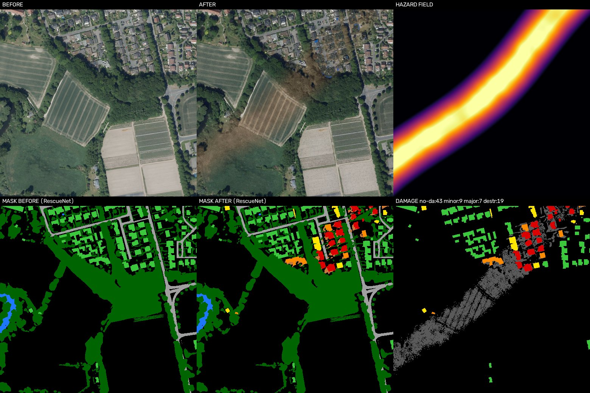

# Village → post-catastrophe

Transforme une image aérienne d'un **village intact** en la **même scène après une catastrophe**
(séisme, ouragan, tornade, inondation ou feu de forêt), avec des **labels exacts** pour entraîner un
modèle de détection des dégâts.



## Lancer le site

Il faut Python 3.10 ou plus récent.

```bash
git clone https://github.com/Moha-df/post-disaster-villages.git
cd post-disaster-villages
pip install -r requirements.txt
python app.py
```

Ouvrir ensuite **http://127.0.0.1:7860** dans le navigateur.

Sur le site, on peut :
- choisir un village, une catastrophe, la sévérité, la direction du vent ou la surface inondée ;
- cliquer sur l'image pour placer l'épicentre, le passage de la tornade ou le départ du feu ;
- comparer l'avant et l'après avec un curseur, et voir les dégâts, les masques et la carte d'aléa ;
- tester Albumentations (onglet du même nom) ;
- télécharger le résultat en `.zip`.

## Générer tout le jeu de données

```bash
python generate.py                     # 8 villages x 5 catastrophes, dans output/
python generate.py --scenarios flood wildfire --n-per-scenario 3 --severity 0.6
```

Pour télécharger d'autres villages depuis OpenEarthMap :

```bash
python download_villages.py --n 20 --out data/villages_big
python generate.py --images data/villages_big/images --masks data/villages_big/masks --out output_big
```

## Comment ça marche

1. **Entrée** : une photo aérienne et son **masque de segmentation**, une image où chaque pixel porte un
   numéro de classe (8 = bâtiment, 4 = route, 5 = arbre, 6 = eau...). Ces masques ont été annotés à la
   main dans [OpenEarthMap](https://open-earth-map.org), qui couvre 44 pays. On sait donc déjà où sont
   les maisons.
2. **Carte d'aléa** : elle indique où la catastrophe frappe fort (distance à l'épicentre, rafales de
   vent, couloir de tornade, profondeur d'eau, front de feu).
3. **Dégâts** : chaque maison reçoit un niveau (intact, mineur, majeur, détruit). Le code le dessine
   sur la photo (toits arrachés, décombres, eau, brûlures) et écrit en même temps l'étiquette dans le
   masque.
4. **Albumentations** ([albumentations.ai](https://albumentations.ai)) intervient ensuite. Il donne à
   l'image après l'aspect d'une autre prise de vue (couleurs, bruit, nuages) et découpe des crops
   alignés avant/après/masque pour l'entraînement.

## Sorties (`output/`)

| Dossier | Contenu |
|---|---|
| `before/`, `after/` | Images avant et après |
| `masks_before/`, `masks/` | Masques au format RescueNet (0 fond, 1 débris, 2 eau, 3 à 6 bâtiment intact → détruit, 8 route, 9 arbre...) |
| `xbd/`, `labels_xbd/` | Dégâts au format xBD : image et polygones JSON |
| `change/`, `hazard/` | Pixels modifiés, carte d'aléa |
| `augmented/` | Crops Albumentations alignés |
| `previews/` | Aperçus en 6 panneaux |

## Fichiers

| Fichier | Rôle |
|---|---|
| `app.py` | Le site |
| `generate.py` | Génération du jeu de données en ligne de commande |
| `download_villages.py` | Choix et téléchargement des villages OpenEarthMap |
| `postdisaster/` | Moteur : aléa (`hazard.py`), rendu des dégâts (`effects.py`), Albumentations (`augment.py`) |

## Licences

Les données OpenEarthMap sont réservées à la recherche non commerciale (CC BY-NC-SA 4.0). Les images
générées sont synthétiques : un modèle entraîné dessus doit être évalué sur de vraies images
post-catastrophe.

Xia et al., *OpenEarthMap: A Benchmark Dataset for Global High-Resolution Land Cover Mapping*,
WACV 2023.
